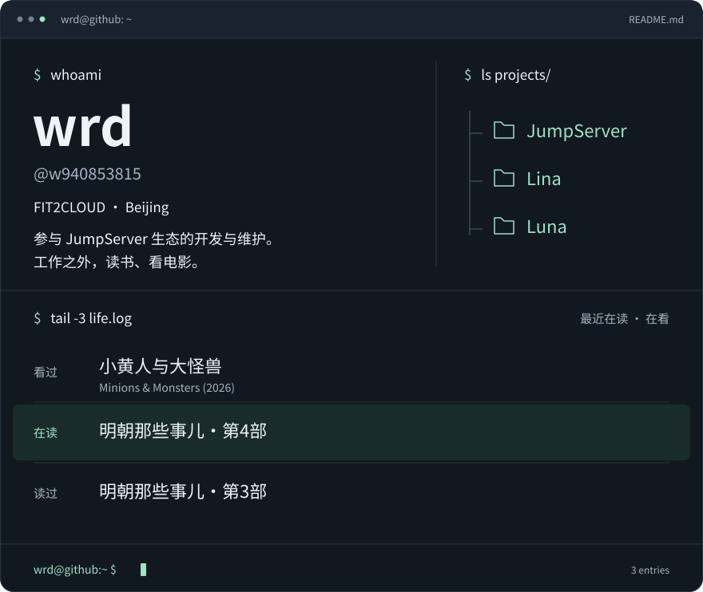

<picture>
  <source media="(max-width: 1011px)" srcset="assets/profile-mobile.svg">
  
</picture>

打开项目与书影音链接

**项目**

[JumpServer](https://github.com/jumpserver/jumpserver) · [Lina](https://github.com/jumpserver/lina) · [Luna](https://github.com/jumpserver/luna)

**最近在读 · 在看**

<!-- DOUBAN-ACTIVITIES:START -->
- [看过 小黄人与大怪兽 Minions & Monsters‎ (2026)](https://www.douban.com/doubanapp/dispatch?uri=%2Fstatus%2F9800930862%2F%3F_spm_id%3DMTM2MDY5MjM4&_i=91766849)
- [在读 明朝那些事儿·第4部](https://www.douban.com/doubanapp/dispatch?uri=%2Fstatus%2F9793023538%2F%3F_spm_id%3DMTM2MDY5MjM4&_i=91766849)
- [读过 明朝那些事儿·第3部](https://www.douban.com/doubanapp/dispatch?uri=%2Fstatus%2F9793022068%2F%3F_spm_id%3DMTM2MDY5MjM4&_i=91766849)
<!-- DOUBAN-ACTIVITIES:END -->

[仓库](https://github.com/w940853815?tab=repositories) · [收藏](https://github.com/w940853815?tab=stars) · [豆瓣](https://www.douban.com/people/136069238/) · [统计](https://next.ossinsight.io/widgets/official/compose-user-dashboard-stats?user_id=17764568)

