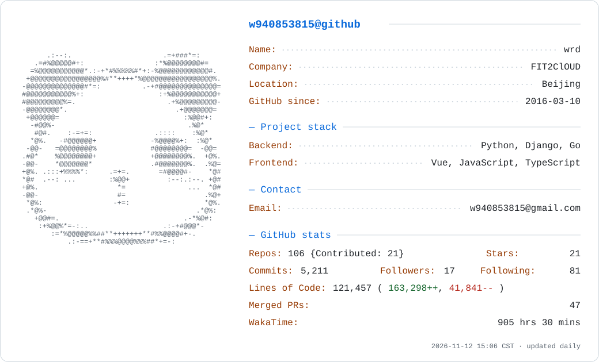

<a href="./docs/statistics.md">
  <picture>
    <source media="(max-width: 600px) and (prefers-color-scheme: dark)" srcset="./assets/profile-mobile-dark.svg">
    <source media="(max-width: 600px)" srcset="./assets/profile-mobile.svg">
    <source media="(prefers-color-scheme: dark)" srcset="./assets/profile-dark.svg">
    
  </picture>
</a>

### 🚀 Projects I Contribute To

| Project | Description | Stack |
| --- | --- | --- |
| [JumpServer](https://github.com/jumpserver/jumpserver) | Open-source privileged access management platform | Python, Django |
| [Lina](https://github.com/jumpserver/lina) | JumpServer's web UI | Vue, JavaScript |
| [Luna](https://github.com/jumpserver/luna) | JumpServer's workspace and web terminal | Vue, TypeScript |
| [KoKo](https://github.com/jumpserver/koko) | Connector for SSH, Telnet, Kubernetes, SFTP, and databases | Go |

<!--
**w940853815/w940853815** is a ✨ _special_ ✨ repository because its `README.md` (this file) appears on your GitHub profile.

Here are some ideas to get you started:

- 🔭 I’m currently working on ...
- 🌱 I’m currently learning ...
- 👯 I’m looking to collaborate on ...
- 🤔 I’m looking for help with ...
- 💬 Ask me about ...
- 📫 How to reach me: ...
- 😄 Pronouns: ...
- ⚡ Fun fact: ...
-->
